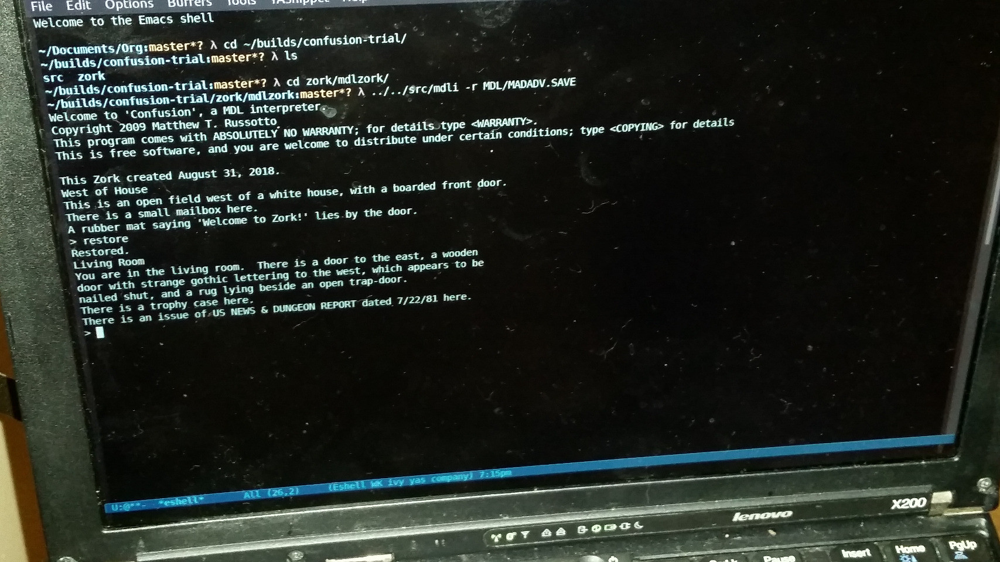

* Flatheadian MDL interpreter :ATTACH:
:PROPERTIES:
:ID:       d549a986-56a2-458f-bb4d-1e443b6fe587
:END:
This is *Convolution*, a fork and slightly expanded version of  *Confusion*, [[https://web.archive.org/web/20170313024629/http://www.russotto.net/git/mrussotto/confusion/src/master/src][Matthew T. Russotto's C/C++ MDL interpreter]], designed for the purpose of being be able to run [[https://en.wikipedia.org/wiki/Infocom][Infocom]]'s old game sources written in [[https://en.wikipedia.org/wiki/MDL_(programming_language)][MDL, MIT's Model Development Language]], a weird Lisp with ~<...>~ rather than ~(...)~ (that's not actually how it works: ~<...>~ is a =form=, a function call; ~(...)~ is retained for =lists= proper; ~[...]~ for =vectors=; and ~{...}~ for =uvectors= (uniform vectors, all elements of same data type, saving memory)), with an obvious play on /muddle/ (and thus Russotto's /confusion/).

My fork, Convolution,  slightly extends the Confusion MDL implementation with some largely unnecessary and somewhat convoluted machinery intended to replace the shell scripts I originally designed to  orchestrate basic UI and file management around running [[https://en.wikipedia.org/wiki/Zork#Inception][old versions of the text adventure/interactive fiction game Zork]]: Confusion implements just enough MDL to be able to most muddle along through these, and Convolution's extensions support a largely MDL-implemented "old Zork" package: [[https://github.com/FCM-2-Quendorian-Muddle-Pipeworks/zork-vaxum-mdl][=zork-vaxum-mdl=]]. Why? Because I could (roughly). 

So, *Convolution* is based on Russotto's original MDL interpreter implementation Confusion, including the [[https://gitlab.com/emacsomancer/confusion-mdl][patches I myself made to get it running under later versions of GCC back in 2018]], and [[https://github.com/heasm66/mdlzork][Henrik Åsman's later (2021-2024) patches and (patched games files in MDL and Fortran)]], and newly implemented extensions which convolute the design somewhat as a basis for some niceties/quality of life improvements all centred on running =zork-vaxum-mdl=. You might be able to do some other basic things with Convolution/Confusion, especially with some of the extensions, but doubtfully much that that's useful (i.e. that couldn't be as easily accomplished in shell or python or lua or whatever.)

So, you'll probably want to install [[https://github.com/FCM-2-Quendorian-Muddle-Pipeworks/zork-vaxum-mdl][zork-vaxum-mdl]] after this to have much to do with it.

Anyway, here's an old shot of starting up (the old 2009) Confusion back in 2018:

Historical README notes from the original release of Confusion continue below:

* Confusion: A MDL interpreter  [earliest README]
** (or, "How to Fit a Small Program into a Large Machine")
*** created by Matthew Russotto - (original at [[https://web.archive.org/web/20190203024317/http://www.russotto.net/git/mrussotto/confusion][http://www.russotto.net/git/mrussotto/confusion]] )

For those poor souls still stuck in dawn of IF history, I present 
"Confusion" -- a MDL interpreter which works just well enough to play 
the original Zork all the way through.  The original Zork isn't for the 
faint of heart, and neither is Confusion; it is only available in 
source form, with minimal instruction (which follows).

Confusion is written in C++, though about 99% is pure C. To build it, you 
will need the Boehm-Demers-Weiser conservative garbage collector for 
C:  <http://www.hpl.hp.com/personal/Hans_Boehm/gc/> 
Some Linux distros have this as a package, called "gc-dev" or 
similar.  For the Mac, you'll need what is at this writing the very latest
version (7.2alpha2), for Linux, 6.8 appears to work.  For Windows... I 
recommend running Linux in a virtual machine.  It might build under 
cygwin, but I wouldn't bet on it. 

Once you have the GC, a simple "make" will build the interpreter. 
The Zork sources, somewhat modified for the limitations of this 
interpreter, are available at: <http://www.russotto.net/~mrussotto/confusion/mdlzork.tgz>
[*Note:* original site seems to be offline; access an archived version instead at: <https://web.archive.org/web/20170801091842/http://www.russotto.net/~mrussotto/confusion/mdlzork.tgz> ]

[see also <https://github.com/itafroma/zork-mdl> ]

To play Zork, unpack this directory, change directory to the new 
"mdlzork" directory, run the interpreter with the parameter ~-r MDL/MADADV.SAVE~ 
e.g. ~../confusion-src/mdli -r MDL/MADADV.SAVE~. 
You should be at the white house: 

#+BEGIN_SRC 
$ ../confusion-src/mdli -r MDL/MADADV.SAVE 

This Zork created July 6, 2009. 

West of House 

This is an open field west of a white house, with a boarded front 
door. 

There is a small mailbox here. 

A rubber mat saying 'Welcome to Zork!' lies by the door. 
#+END_SRC

The HELP, DOC and INFO commands do not work, as I do not have those files. 
I have played Zork all the way through, however, I have made some 
changes to the intepreter since then, so I cannot guarantee success.  If the 
interpreter crashes, let me know.  (note that there are bugs in the 
game; if you get dumped to a MDL LISTEN prompt, this might not be an 
interpreter bug) 
If you modify the MDL sources, you can re-build the game by running 
the interpreter with no parameters in the mdlzork directory, and 
typing:

~<FLOAD "run.mud">~

[You'll almost certainly have to re-build the game as above.]

This will rebuild the MDL/MADADV.SAVE file and start the game. 

Confusion probably won't be developed further.

Notable features not supported: proper SAVE/RESTORE (an incompatible but
useful version is provided), GC-DUMP/GC-READ,  interrupts, processes, 
overflow, compiled code.

------
** Addendum

B. Slade: Minor updates to make it compile with recent versions of gcc

------
* Read more about playing the PDP-10 version of Zork here:

<https://babbagefiles.xyz/zork-confusion/>

* *NOTE: original developed on gitlab, forked from mrussotto
- old versions:
  - https://github.com/emacsomancer/confusion-mdl_pdp10-zork/tree/2018-patched
  - https://gitlab.com/emacsomancer/confusion-mdl/
- orignally forked from: https://web.archive.org/web/20170801091842/http://www.russotto.net/~mrussotto/confusion/

